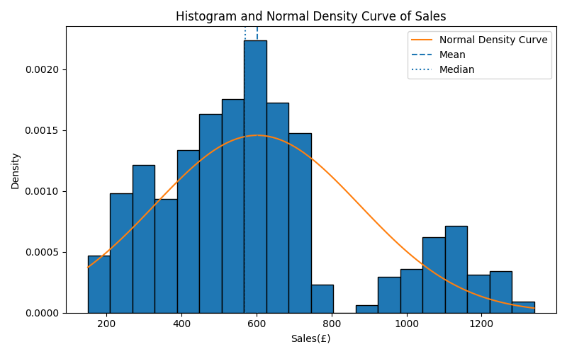
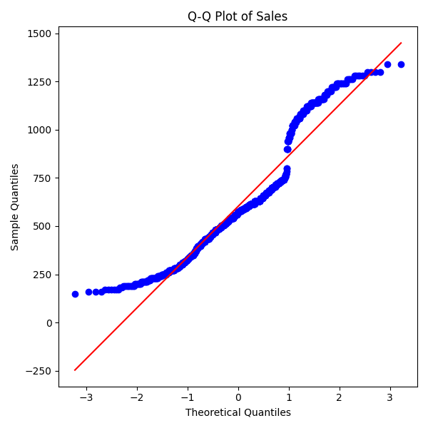
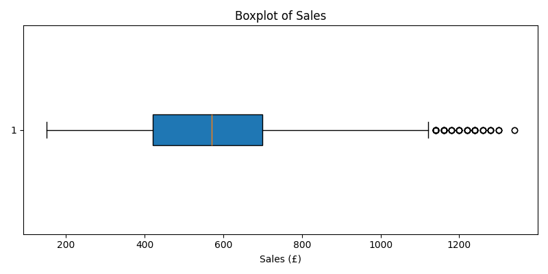
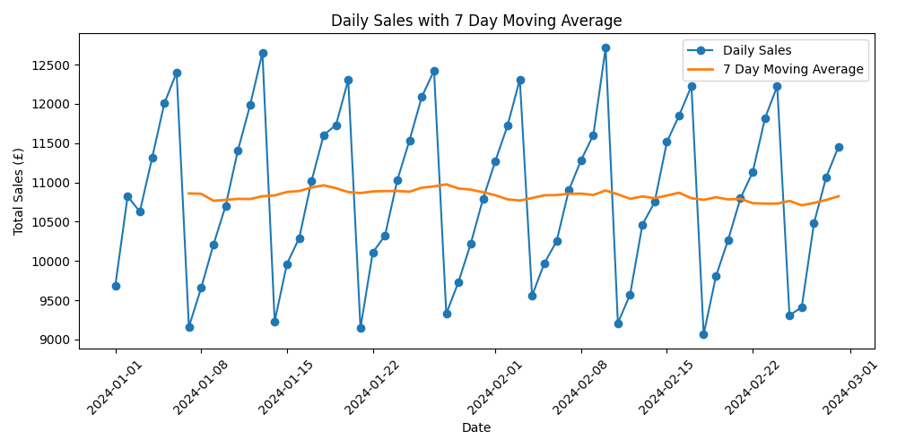
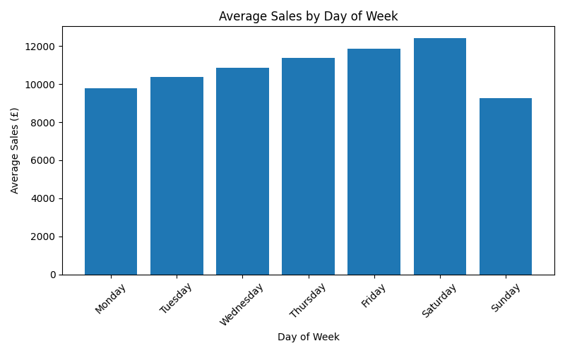

# Retail Sales Analysis: EDA, Statistical Testing & Business Insights

**Python | Pandas | NumPy | SciPy | Matplotlib | Statistical Analysis | Time Series**

## Project overview

How can a retailer use sales data to decide where to focus its inventory, staffing and product strategy?

In this project, I analysed sales data from **three retail stores and six products** to evaluate product and store performance, explore sales distributions, identify weekly sales patterns, and test whether observed differences were statistically significant. The analysis combines data preparation, exploratory data analysis (EDA), visualisation, time-series analysis and non-parametric hypothesis testing to turn sales records into practical business recommendations.

This project was developed as part of my MSc Data Science coursework in **Statistical Programming (CO7052)**.

### Dataset at a glance

| Metric | Value |
| --- | ---: |
| Sales observations | 1,080 |
| Retail stores | 3 |
| Products | 6 |
| Analysis period | 1 January – 29 February 2024 (60 days) |
| Total sales revenue | £649,490 |
| Calculated total profit | £321,109 |

## Business questions

- Which products generate the most and least revenue?
- Do the three stores perform differently, and are those differences statistically significant?
- Is the distribution of sales approximately normal, and are there potential outliers?
- What daily and weekly sales patterns could inform staffing and inventory planning?

## Tools and techniques

- **Python:** end-to-end statistical analysis and scripting
- **Pandas:** CSV integration, joins, validation, pivot tables and grouped summaries
- **NumPy:** numerical calculations and descriptive statistics
- **SciPy:** Shapiro–Wilk normality testing and Kruskal–Wallis hypothesis testing
- **Matplotlib:** distribution, outlier and time-series visualisations
- **Statistical methods:** descriptive statistics, skewness, kurtosis, Q–Q plots, z-scores, interquartile ranges, 7-day moving averages and non-parametric group comparisons

## Analytical workflow

### 1. Data integration and validation

I combined `Store_A.csv`, `Store_B.csv` and `Store_C.csv` into one dataset and joined the result with `ProductPricing.csv` using the product identifier. I converted dates to a consistent format, checked for missing values and duplicates, and created two measures:

- **Sales revenue** = Quantity × Selling Price
- **Profit** = Quantity × (Selling Price − Cost Price)

The final dataset contained **1,080 records and 8 columns**, with no missing values or duplicate rows detected.

### 2. Exploratory data analysis

Using pivot tables and grouped aggregations, I calculated total and average sales by store and product, daily sales totals, sales contribution by store and product-level performance rankings.

| Product | Total revenue |
| --- | ---: |
| P3 | £200,600 |
| P4 | £116,228 |
| P2 | £109,080 |
| P6 | £99,540 |
| P5 | £77,532 |
| P1 | £46,510 |

**P3** was the highest-revenue product, while **P1** recorded the lowest revenue. Revenue alone is not a direct measure of demand: differences may also reflect product prices, quantities and margins.

The three stores performed at very similar levels:

| Store | Total revenue |
| --- | ---: |
| Store_A | £216,030 |
| Store_B | £216,595 |
| Store_C | £216,865 |

The gap between the highest- and lowest-revenue stores was just **£835**, against total revenue of £649,490.

### 3. Distribution and normality analysis

I examined individual sales values using a histogram with a fitted normal-density curve, a boxplot and a Q–Q plot. The distribution was right-skewed, with several high-value sales observations.





A **Shapiro–Wilk normality test** returned **W = 0.9221, p ≈ 3.51 × 10⁻²³**. This rejects the normality hypothesis at the 5% significance level. I also used z-scores and the interquartile range to inspect potential outliers rather than automatically discard high-value transactions.



### 4. Time-series and weekly pattern analysis

After aggregating revenue by date, I plotted daily sales and calculated a **7-day moving average** to separate short-term fluctuations from the overall trend.



The moving average remained broadly stable over the 60-day period, while daily revenue followed a repeated weekly pattern. Saturday had the highest average sales, and Sunday the lowest.



| Day | Average total daily revenue |
| --- | ---: |
| Saturday | £12,407.50 |
| Sunday | £9,250.25 |

Saturday's average daily revenue was approximately **34% higher than Sunday's**. This pattern suggests an opportunity to align staffing and stock availability with busier days, although the dataset covers only two months.

### 5. Statistical hypothesis testing

Because the overall sales distribution was not normally distributed, I used the **Kruskal–Wallis test**, a non-parametric method for comparing multiple groups, to examine store-level and product-level sales values.

| Comparison | Kruskal–Wallis H | p-value | Interpretation (α = 0.05) |
| --- | ---: | ---: | --- |
| Three stores | 0.0615 | 0.9697 | No statistically significant difference detected |
| Six products | 920.2875 | < 0.001 | Statistically significant difference detected |

The results indicate stronger evidence of differences **between products** than **between stores**. The omnibus product test does not, on its own, identify which individual product pairs differ; that would require post-hoc testing.

## Key business insights and recommendations

1. **Prioritise product-level decisions.** Product sales differ significantly, while the store-level comparison did not show a significant difference. Focus further investigation on product assortment, pricing and margins rather than assuming a particular store needs intervention.
2. **Plan stock availability for P3.** As the highest-revenue product, P3 is a useful starting point for inventory planning, particularly ahead of high-sales days. Assess quantities and margins before changing stock targets.
3. **Investigate P1 before making assortment changes.** Its lower revenue warrants review of price, demand, profit contribution and merchandising rather than immediate discontinuation.
4. **Use weekly patterns to inform operations.** Consider stronger staffing and inventory coverage toward Friday and Saturday, and test targeted promotions for Sundays.
5. **Collect more data before long-term forecasting.** Sixty days reveal a recurring weekly pattern but are insufficient to establish annual seasonality or holiday effects.


## How to run

**Prerequisites:** Python 3 and the packages listed below.

```bash
pip install pandas numpy scipy matplotlib
```

Clone or download this repository, keep the four CSV files alongside `dataintegration.py`, and run:

```bash
python dataintegration.py
```

The script prints the analytical results to the terminal and saves six PNG charts to the same directory. The supplied datasets are coursework datasets; the results should not be interpreted as findings about a real named retailer.

## Limitations and next steps

- The analysis covers only **60 days**, limiting conclusions about longer-term seasonality.
- Product revenue differences partly reflect **selling prices**, not just sales volume or consumer demand.
- The Kruskal–Wallis results are **overall group tests**; post-hoc pairwise tests and effect-size estimates could provide more detail.
- Further work could explore product profitability, formal comparisons of weekday effects and forecasting with a longer time series.

## What this project demonstrates

This project demonstrates my ability to **integrate and validate data, analyse commercial KPIs, visualise patterns, select statistical tests based on the data, and communicate evidence-based recommendations**. It reflects the analytical workflow I aim to bring to data analyst and data scientist roles: moving from raw data to reliable results and then to decisions that matter to a business.
